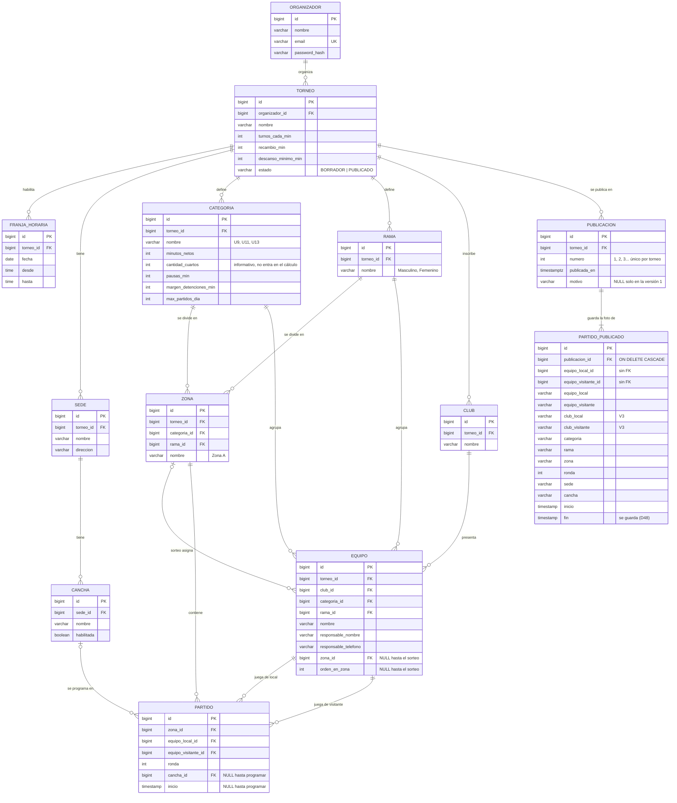

# DER — Modelo de datos (P0)

> DDL completo en las migraciones Flyway [`V1__esquema_inicial.sql`](../backend/src/main/resources/db/migration/V1__esquema_inicial.sql)
> , [`V2__publicaciones.sql`](../backend/src/main/resources/db/migration/V2__publicaciones.sql) (versiones publicadas)
> y [`V3__club_en_foto.sql`](../backend/src/main/resources/db/migration/V3__club_en_foto.sql) (club en la foto).
> Cubre solo el alcance P0 de `CLAUDE.md`: no hay comidas, resultados, fase final ni jugadores.

## Diagrama

`PARTIDO_PUBLICADO` no tiene relación con `EQUIPO` ni con `PARTIDO`: es una foto con textos. Los ids de los equipos
sirven para filtrar el fixture de un equipo, pero no son claves foráneas (D46).

## Entidades

| Entidad | Qué representa | Notas |
|---|---|---|
| `organizador` | Usuario que crea y administra torneos | Único usuario con login. El público no se registra |
| `torneo` | Un torneo con sus parámetros generales | `turnos_cada_min`, `recambio_min`, `descanso_minimo_min`, `estado` |
| `franja_horaria` | Ventana de juego de un día (R4) | Los días del torneo salen de acá; no se guardan fechas de inicio/fin |
| `sede`, `cancha` | Dónde se juega (R5) | `habilitada` permite sacar una cancha sin borrarla |
| `categoria` | U9, U11, U13… con los parámetros de duración y tope diario (R6) | Los parámetros que en `restricciones.md` son "nivel categoría". `cantidad_cuartos` es informativo (ver abajo) |
| `rama` | Masculino, Femenino… | Configurable, no es un enum fijo |
| `zona` | Grupo de una categoría y rama | La cantidad de zonas es la cantidad de filas, no un campo aparte |
| `club` | Club que inscribe equipos | Por torneo. Puede coincidir con una sede, pero son conceptos distintos |
| `equipo` | Equipo inscripto | Solo responsable y teléfono como datos personales. `zona_id` + `orden_en_zona` = resultado del sorteo |
| `partido` | Enfrentamiento del fixture | Lo crea el generador (zona, equipos, ronda) y lo completa el programador (cancha, inicio). La base no impide asignar una cancha de otro torneo: eso lo controla R5 |
| `publicacion` | Una versión publicada del fixture (V2) | Número 1, 2, 3… por torneo. La última es la que ve el público. El motivo es obligatorio desde la versión 2 |
| `partido_publicado` | Foto de un partido tal como se publicó (V2, club en V3) | Textos desnormalizados (equipos y sus clubes, zona, sede, cancha, horarios), inmutable: nunca se hace UPDATE. Cambiar equipos, clubes, canchas o configuración no la afecta |

## Versiones publicadas (D46, D47, D48)

- **Publicar** valida R1–R8 y, en la misma transacción, crea la publicación N+1 con la foto de todos los partidos.
- **Reabrir** pasa el torneo de PUBLICADO a BORRADOR para corregirlo. La vista pública sigue mostrando la última
  versión, y la siguiente publicación exige un motivo.
- **La vista pública lee siempre la foto** de la última publicación, nunca las tablas vivas (`partido`, `equipo`,
  `cancha`…). Un torneo nunca publicado no existe para el público.
- **La foto guarda el `fin`** del partido, a diferencia de `partido` (D8): es el horario que se comunicó, y no tiene
  que cambiar si después cambian las duraciones de la categoría (D48).
- **La foto guarda el club** de cada equipo (V3): las familias buscan el fixture por club (D48).

## Cálculos que no se guardan (D8)

| Dato | Cómo se obtiene |
|---|---|
| Duración programada | `minutos_netos + pausas_min + margen_detenciones_min` (categoría) `+ recambio_min` (torneo) |
| Bloque | Duración programada redondeada hacia arriba al múltiplo de `turnos_cada_min` |
| Fin del partido | `inicio + bloque` |
| Categoría y rama del partido | Las de su zona |
| Equipo "libre" en una ronda | El equipo de la zona que no figura en ningún partido de esa ronda |
| Días del torneo | Fechas distintas de `franja_horaria` |

**`cantidad_cuartos` no participa del cálculo.** `minutos_netos` ya es el total de juego (ej. U9: 4 × 7 = 28) y
`pausas_min` ya suma todas las pausas (1' + 2' + 1' = 4). Se guarda porque `restricciones.md` lo lista como
parámetro de la categoría y sirve para mostrar el formato del partido (4 cuartos de 7 minutos).
No es un dato derivado: no se puede obtener de las otras columnas.

## Qué garantiza la base y qué garantiza el backend

La base asegura que los datos sean **coherentes entre sí**; las reglas del fixture R1–R8 las verifica
**solo** el `ValidadorRestricciones` (regla 3 de `CLAUDE.md`), para no duplicar lógica.

| Garantía | Dónde | Cómo |
|---|---|---|
| Categoría, rama y club de un equipo son del mismo torneo | Base | FKs compuestas `(id, torneo_id)` |
| Un equipo solo puede caer en una zona de su categoría y rama | Base | FK `(zona_id, categoria_id, rama_id)` → `zona` |
| Los dos equipos de un partido son de la zona del partido | Base | FK `(equipo_id, zona_id)` → `equipo` |
| Un equipo no juega contra sí mismo | Base | `CHECK (equipo_local_id <> equipo_visitante_id)` |
| Un equipo con partidos no se puede cambiar de zona (D5) | Base | Mismas FKs: hay que borrar los partidos antes |
| Un partido está sin programar o tiene cancha **e** inicio | Base | `CHECK ((cancha_id IS NULL) = (inicio IS NULL))` |
| Solo existen los estados BORRADOR y PUBLICADO | Base | `CHECK` |
| Parámetros positivos / no negativos | Base | `CHECK` |
| La cancha de un partido pertenece al torneo del partido y está habilitada | Backend | R5 en `ValidadorRestricciones` |
| R1–R8 (superposiciones, descanso, franjas, tope, turnos, completitud) | Backend | `ValidadorRestricciones` |
| No se sortea, genera, programa ni configura un torneo PUBLICADO; para corregirlo hay que reabrirlo (D20, D39, D47) | Backend | Servicio, antes de llamar al generador o al programador |
| Número de versión único por torneo; motivo obligatorio desde la versión 2 | Base | `UNIQUE (torneo_id, numero)` y `CHECK` |
| La foto publicada no se modifica | Backend | Entidades `@Immutable` sin setters; ninguna operación la actualiza |
| La vista pública muestra solo lo publicado | Backend | `ConsultaPublicaServicio` lee solo `partido_publicado` |

R1 y R2 no se pueden expresar en la base sin guardar el fin del partido, que es un dato derivado (D8).

R5 tampoco se controla en la base: `partido.cancha_id` apunta a cualquier `cancha`, sin verificar que su sede sea
del torneo de la zona del partido. Hacerlo con FKs obligaría a copiar `torneo_id` en `cancha` y `partido`;
como R5 ya tiene que estar en el validador (también verifica `habilitada`), se deja ahí para no duplicar la regla.
