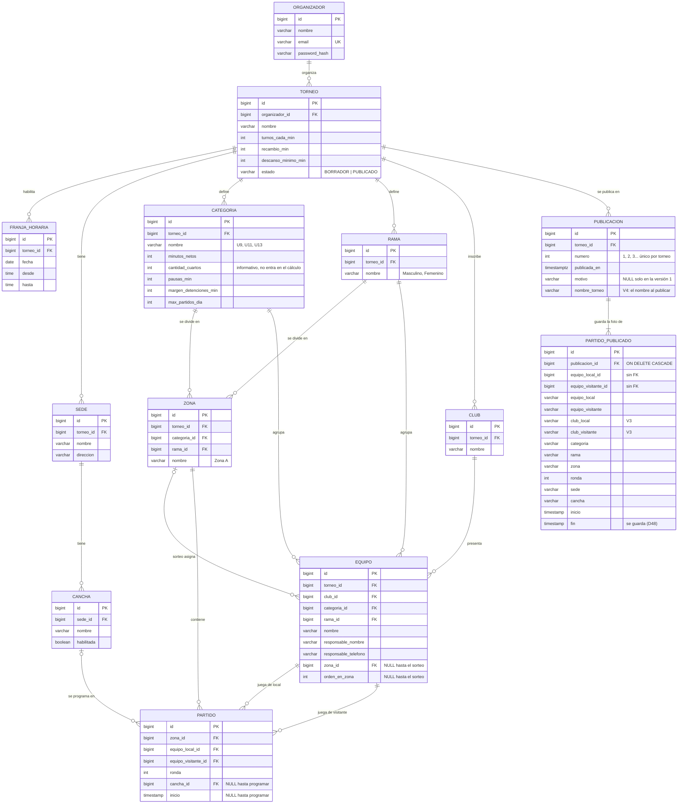
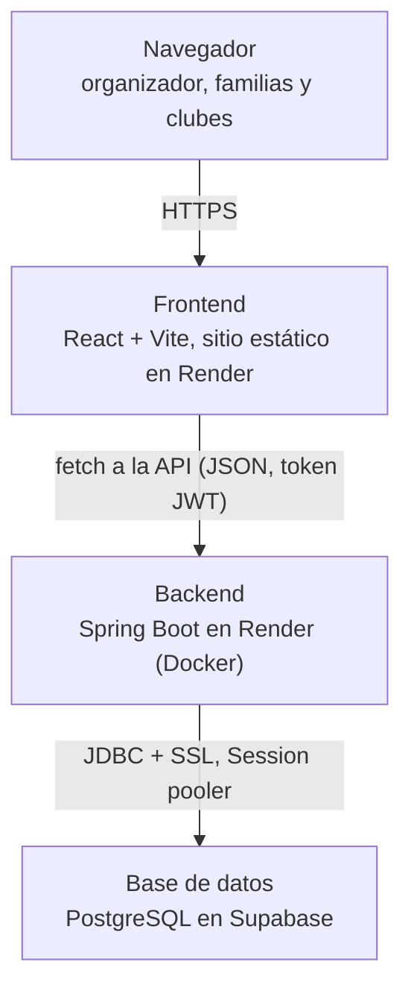
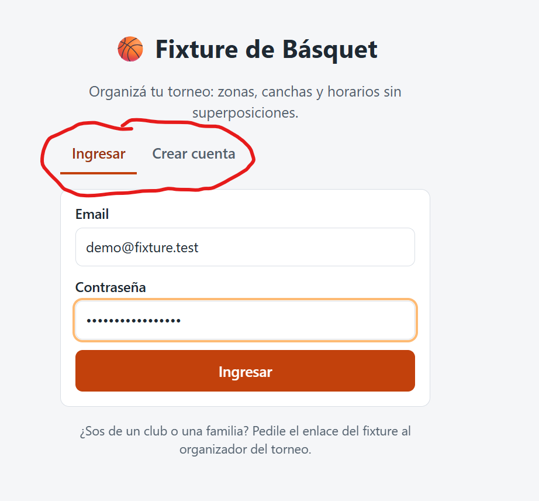
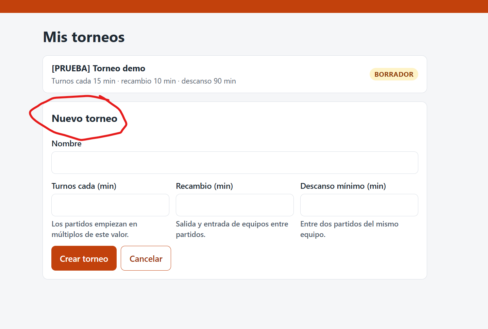
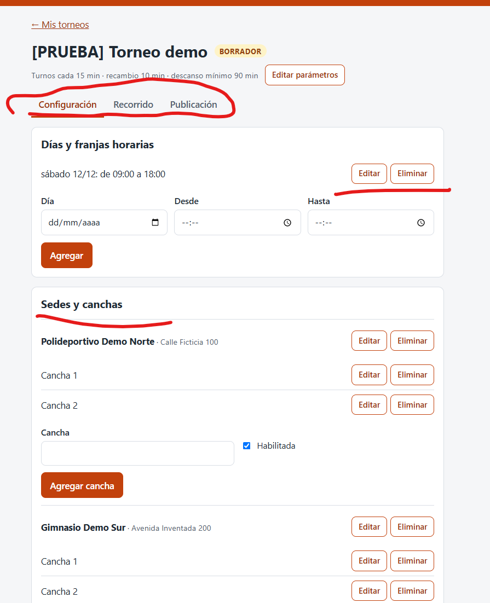
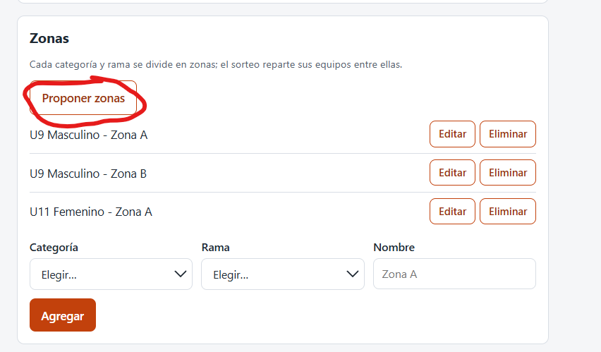
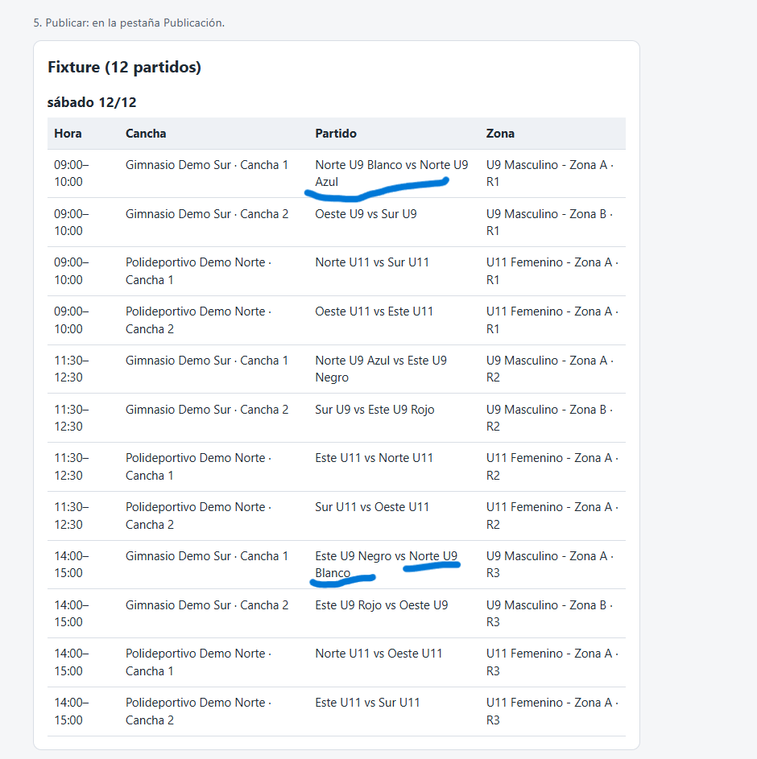
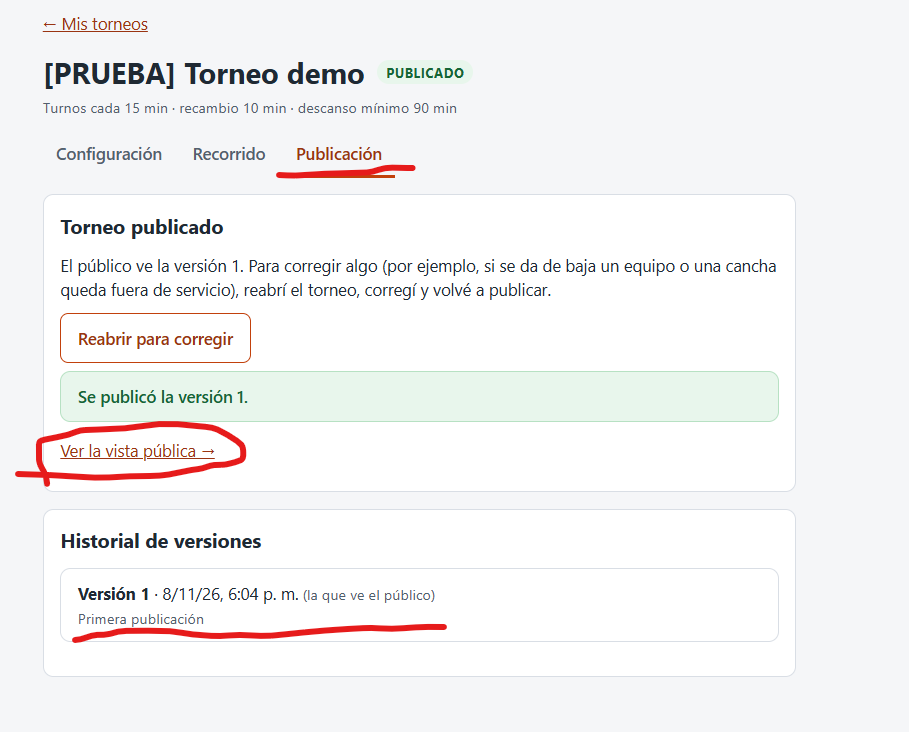
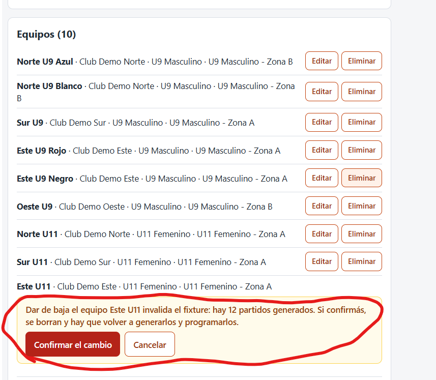
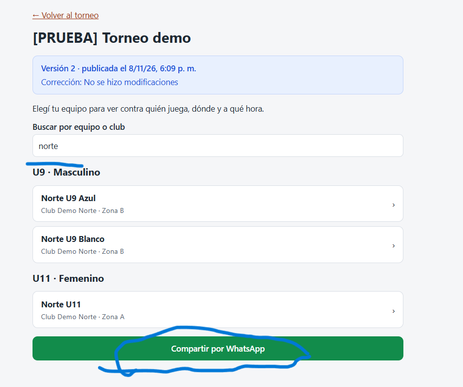

<div align="center">

# Universidad Tecnológica Nacional

## Tecnicatura Universitaria en Programación (a distancia)

### Materia: Proyecto Final

# Fixture de Básquet

### Informe Final del Proyecto

**Grupo 165**

Daniel Alderete · Tadeo Acosta

**Tutor:** Oscar Londero

2026

</div>

---

> **Versión del proyecto a la que corresponde este informe:** [PENDIENTE: commit, tag o release de la entrega final]
>
> En todo el informe se distingue lo **implementado y probado** de lo que es **trabajo futuro**. Las decisiones
> técnicas se citan por su número (Dxx) y están justificadas en [`docs/decisiones.md`](decisiones.md).

## Índice

1. [Problema y contexto](#1-problema-y-contexto)
2. [Objetivos y alcance](#2-objetivos-y-alcance)
3. [Análisis y modelo](#3-análisis-y-modelo)
4. [Generación de enfrentamientos y programador](#4-generación-de-enfrentamientos-y-programador)
5. [Arquitectura y tecnologías](#5-arquitectura-y-tecnologías)
6. [Implementación](#6-implementación)
7. [Pruebas y validación](#7-pruebas-y-validación)
8. [Resultados y conclusiones](#8-resultados-y-conclusiones)
9. [Enlaces](#9-enlaces)

---

## 1. Problema y contexto

### Situación

En los torneos formativos de básquet de clubes del interior, el fixture se arma a mano. El caso relevado es un torneo
real que se juega en **María Juana**, con sedes en el Club Atlético María Juana y el Club Litoral María Juana
([`caso-real.md`](caso-real.md)). Así se organiza hoy:

| Tarea | Cómo se hace hoy |
|---|---|
| Enfrentamientos (quién juega contra quién) | Por sorteo |
| Asignación de cancha y horario | A mano |
| Esfuerzo | **2 días de reuniones de 5 horas cada uno (≈ 10 horas)** |
| Difusión | Canales informales (WhatsApp, grupos) |

Los problemas que aparecen: partidos superpuestos, canchas ociosas, equipos que no saben dónde ni cuándo juegan, y
cualquier cambio (un equipo que se baja, una cancha que no está disponible) obliga a rehacer la grilla a mano.

### Actores

| Actor | Qué necesita | Cómo usa el sistema |
|---|---|---|
| **Organizador del torneo** | Armar un fixture sin conflictos y corregirlo si algo cambia | Cuenta propia: configura, genera, programa, valida y publica |
| **Clubes y familias** | Saber contra quién, dónde y a qué hora juega su equipo | Vista pública, sin cuenta, desde el celular |
| **Responsable de cada equipo** | Que lo contacten | Solo se guarda su nombre y teléfono; no se muestran en público |

### Evidencia

- **Torneo real como caso principal** (D2): el torneo de María Juana con **55 equipos**, categorías U9, U11 y U13 en
  rama masculina y femenina, **2 sedes × 4 canchas**, sábado de 9 a 20 y domingo de 9 a 16. El relevamiento se hizo
  con el organizador real en una charla en persona el 24/09/2026, y se completó por WhatsApp. El organizador aportó
  la cantidad de equipos, las categorías, las ramas, las sedes, las duraciones de los partidos y las reglas del
  torneo, y describió cómo se organiza hoy: el armado de la grilla lleva ≈ 10 horas de reuniones, a las que se suman
  la comunicación a los equipos y los cambios del fixture cuando algo se modifica.
- **Análisis de factibilidad** sobre ese caso ([`caso-real.md`](caso-real.md), sección 3): con un tope de 3 partidos
  por día, un equipo juega como máximo 6 partidos en el fin de semana. Con todos contra todos por categoría, 5 de los
  6 grupos no entran (por ejemplo, un equipo de U9 masculino necesitaría 9 partidos) y harían falta ≈ 261 horas de
  cancha contra 144 disponibles.
- **Consultas posteriores con el organizador** sobre decisiones del algoritmo (sección 7.4).
- **Devoluciones del tutor**, que orientaron el recorte del alcance (en el repositorio, [`docs/devoluciones/`](devoluciones/)).

### Necesidad concreta

Una herramienta **simple, gratuita y en español** que, a partir de la configuración del torneo, arme los
enfrentamientos por zonas, los programe en canchas y horarios **sin violar ninguna regla**, avise con claridad cuando
eso no es posible, y publique el resultado en un enlace que se pueda compartir por WhatsApp.

---

## 2. Objetivos y alcance

### Objetivo general

Desarrollar una aplicación web que genere y publique el fixture de un torneo formativo de básquet por zonas,
programando cada partido en una cancha y un horario que respeten las restricciones obligatorias del torneo, y que
informe cuándo no existe o no se encontró una programación válida.

### Alcance implementado y probado (P0)

| Funcionalidad | Decisiones |
|---|---|
| Cuenta de organizador (registro e inicio de sesión) y aislamiento: cada organizador ve y edita solo sus torneos | D42, D44, D45 |
| Configuración del torneo: parámetros, días y franjas, sedes y canchas, categorías, ramas, clubes, zonas y equipos (alta, edición y baja) | D19, D56, D66, D68 |
| Propuesta automática de zonas según un máximo de equipos por zona | D69 |
| Sorteo de zonas (resultado guardado) | D5, D16, D26, D40 |
| Generación de enfrentamientos: todos contra todos dentro de cada zona, con fecha libre si la zona es impar | D3, D4, D25, D27 |
| Programación en cancha y horario respetando R1–R8, con chequeo previo de factibilidad | D33–D36 |
| Validación R1–R8 con un único validador, antes de publicar | D6, D14, D29, D65 |
| Estados BORRADOR / PUBLICADO, publicación versionada e inmutable, reabrir con motivo | D11, D46, D47, D48, D70 |
| Vista pública sin login por torneo y por equipo, con botón para compartir por WhatsApp | D57, D60, D62 |
| Mensajes de error en español | D61 |
| Despliegue en Render (backend y frontend) con base en Supabase | D49–D53, D58 |

### Lo que quedó fuera y por qué

| Funcionalidad | Por qué quedó fuera |
|---|---|
| Turnos de comida (estaba en la propuesta original) | Recorte acordado con el tutor: primero tenía que funcionar el generador (D12) |
| Fase final o cruces entre zonas | Fuera de P0 (D3, D12); cada zona tiene su ganador |
| Carga de resultados y estadísticas | Fuera de P0; no hace falta para armar y difundir el fixture |
| Edición manual de un partido suelto (o arrastrar partidos) | Fuera de P0 (D12). Si se agrega, se validaría con el mismo `ValidadorRestricciones` |
| Reparto uniforme de partidos entre sábado y domingo | Se consultó al organizador y no lo necesita (D64); quedaría como preferencia de optimización, no como regla |
| Optimización de tiempos muertos entre partidos | Fuera de P0: el fixture es válido aunque haya canchas libres entre rondas |
| Jugadores, pagos, notificaciones, roles distintos al organizador | Fuera del problema que se buscó resolver |

---

## 3. Análisis y modelo

### Entidades y relaciones

El modelo completo está en [`der.md`](der.md). El esquema se crea con cuatro migraciones Flyway (V1 a V4, D21) y tiene
13 tablas del dominio.



| Entidad | Qué representa |
|---|---|
| `organizador` | Único usuario con login. Su contraseña se guarda como hash (D42) |
| `torneo` | Parámetros generales (turnos cada, recambio, descanso) y estado BORRADOR / PUBLICADO |
| `franja_horaria`, `sede`, `cancha` | Cuándo y dónde se puede jugar. Una cancha se puede deshabilitar sin borrarla |
| `categoria`, `rama`, `club` | Tablas por torneo, no valores fijos en el código (D19) |
| `zona`, `equipo` | El resultado del sorteo se guarda en el equipo: `zona_id` y `orden_en_zona` (D16) |
| `partido` | Lo crea el generador (zona, equipos, ronda) y lo completa el programador (cancha, inicio) (D15) |
| `publicacion`, `partido_publicado` | Cada versión publicada y su "foto" de los partidos (D46) |

### Reglas de negocio

- **Ningún parámetro del torneo está fijo en el código.** Duraciones, descanso, tope diario, "turnos cada" y franjas
  vienen de la configuración; los valores del caso real solo aparecen en datos de ejemplo y tests.
- **Datos derivados que se calculan, no se guardan (D8, D18):** la duración programada, el bloque y el fin de un
  partido, las fechas libres y la cantidad de zonas.

  ```
  duración programada = minutos netos + pausas + margen por detenciones + recambio
  bloque              = duración programada redondeada hacia arriba al múltiplo de "turnos cada"
  fin                 = inicio + bloque
  ```

  Ejemplo U13 del caso real: 40 + 4 + 10 + 10 = 64 min → bloque de 75 min (D7).
- **La base garantiza la coherencia, el backend las reglas del fixture (D14, D17).** Claves foráneas compuestas
  impiden que un equipo, una zona o un partido mezclen torneos, categorías o ramas. Las restricciones R1–R8 las
  verifica solo el `ValidadorRestricciones`.
- **Solo en BORRADOR se modifica (D20, D39, D47).** Con el torneo PUBLICADO la API responde 409 y hay que reabrirlo.
- **Editar algo que invalida el fixture pide confirmación (D66).** Por ejemplo, cambiar una franja con partidos
  programados: la app avisa cuántos partidos se pierden y, si el organizador confirma, borra los partidos generados.
  Nunca quedan partidos que contradigan la configuración.
- **Todo equipo inscripto tiene que tener partidos para publicar (D65).** Un equipo agregado después del sorteo queda
  sin zona y la validación lo informa por su nombre.

### Versionado: cada publicación es una foto inmutable

Pedido del tutor: un torneo publicado puede necesitar corregirse (un equipo que se da de baja, una cancha fuera de
servicio) sin perder lo que ya se comunicó.

1. **Publicar** valida R1–R8 y, en la misma transacción, crea la versión N+1 con una copia de cada partido (D46).
2. La copia guarda **textos**, no referencias: equipos y sus clubes, categoría, rama, zona, ronda, sede, cancha,
   inicio y fin (D48). Las filas son inmutables (`@Immutable`, sin `UPDATE`).
3. **El nombre del torneo también queda congelado en cada versión** (columna `publicacion.nombre_torneo`, migración V4,
   D70). Si el organizador renombra el torneo, el público sigue viendo el nombre publicado hasta la próxima versión.
4. **Reabrir** pasa el torneo a BORRADOR para corregirlo; el público sigue viendo la última versión. Desde la
   versión 2, publicar exige un **motivo**, que se muestra en la vista pública (D47).
5. La vista pública **lee siempre la foto**, nunca las tablas vivas. Un torneo nunca publicado no existe para el
   público.

Por qué el fin y el club se guardan en la foto aunque se puedan calcular: es lo que se comunicó. Si se calcularan al
consultar, cambiar la duración de una categoría o renombrar un club cambiaría el fixture ya publicado (D48).

---

## 4. Generación de enfrentamientos y programador

El fixture se arma en dos problemas separados (D1), cada uno en una clase de dominio pura, sin Spring ni base de
datos (D13), para poder probarlas con JUnit:

| Etapa | Pregunta | Clase |
|---|---|---|
| Propuesta de zonas | ¿Cuántas zonas y de qué tamaño? | `PropuestaZonas` |
| Sorteo | ¿Qué equipo va a cada zona? | `SorteoZonas` |
| Generador | ¿Quién juega contra quién? | `GeneradorEnfrentamientos` |
| Programador | ¿En qué cancha y a qué hora? | `Programador` |
| Validador | ¿Se cumplen R1–R8? | `ValidadorRestricciones` (único) |

### 4.1 Zonas y sorteo

- **Proponer zonas (D69):** con *n* equipos y un máximo *m* por zona se arman ceil(*n* / *m*) zonas, repartidas lo
  más parejo posible. Con *m* = 5, el caso real da exactamente sus 13 zonas. El máximo tiene que ser al menos 3: con 2,
  una cantidad impar de equipos dejaría una zona de un solo equipo.
- **Sorteo (D26):** se mezclan los equipos al azar y se reparten como cartas: las zonas difieren a lo sumo en un
  equipo. El resultado se guarda y no se rehace solo (D5); el azar está solo acá (D27).

### 4.2 Todos contra todos: método del círculo (D25)

Se fija un equipo y los demás rotan una posición por ronda; en cada ronda se enfrentan los que quedan uno frente al
otro. Con *n* equipos da *n* − 1 rondas, cada par se enfrenta una sola vez y nadie juega dos veces en la misma ronda.
Si la zona es impar se agrega un lugar vacío: quien queda enfrentado a él tiene **fecha libre** (D4), que no se guarda,
se deduce (D18). Detalle en [`algoritmo-enfrentamientos.md`](algoritmo-enfrentamientos.md).

### 4.3 Programador greedy (D33–D36)

1. **Chequeo por conteo (D35).** Antes de programar se hacen dos cuentas. Si alguna falla, es **seguro** que no hay
   solución:
   - partidos que necesita cada equipo frente a los que puede jugar (en una franja de L minutos, con bloque B y
     descanso D, como máximo ⌊(L + D) / (B + D)⌋, y nunca más que el tope diario);
   - horas de cancha necesarias frente a las disponibles.
2. **Orden (D33).** Por ronda (primero todas las rondas 1) y, dentro de cada ronda, primero los partidos más difíciles
   (bloque más largo, zona más grande).
3. **Primer casillero válido (D36).** Se recorren los horarios de turno de más temprano a más tarde y, en cada uno, las
   canchas en orden (D37). Para decidir si un casillero sirve, el programador **le pregunta al
   `ValidadorRestricciones`**: así las reglas están escritas en un solo lugar.
4. **Control final.** El fixture completo vuelve a pasar por el validador antes de devolverse.

**Dos mensajes distintos (D34).** El programador es heurístico y no hace *backtracking*: que no encuentre lugar para un
partido no prueba que no exista solución.

| Situación | Mensaje |
|---|---|
| El chequeo por conteo **demuestra** que es imposible | **"No existe una programación válida con la configuración actual"**, con la zona y el equipo que no llegan, o las horas de cancha que faltan |
| El conteo no lo demuestra, pero el greedy **no encuentra** lugar | **"No se encontró una programación válida con la configuración actual"**, con el partido, su zona y su ronda |

En ningún caso el sistema relaja una restricción ni publica un fixture inválido (D10, D41).

### 4.4 Restricciones obligatorias R1–R8 (D6)

| # | Regla | Por qué |
|---|---|---|
| R1 | Una cancha no tiene dos partidos que se pisen (`inicio_B ≥ fin_A`) | Es el conflicto más visible del armado a mano. Se comparan todos los pares, no solo los consecutivos, porque los bloques de distintas categorías duran distinto (D31) |
| R2 | Un equipo no juega dos partidos al mismo tiempo | Un equipo no puede estar en dos canchas a la vez |
| R3 | Entre dos partidos de un equipo hay al menos el descanso mínimo | Cuidado físico de chicos en categorías formativas; también cubre el traslado entre sedes (sección 7.4) |
| R4 | El partido empieza y termina dentro de una franja habilitada | Las sedes están disponibles solo en esos horarios |
| R5 | El partido está en una cancha habilitada del torneo | Una cancha fuera de servicio se deshabilita sin borrarla |
| R6 | Un equipo no juega más del máximo de partidos por día | Regla del torneo (3 en el caso real) |
| R7 | El inicio coincide con un turno válido (9:00, 9:15… si es cada 15), contado desde la apertura de la franja (D30) | Horarios fáciles de comunicar y de cumplir |
| R8 | Todos los partidos generados están programados y todo equipo inscripto tiene partidos (D65) | Un fixture incompleto no se publica |

---

## 5. Arquitectura y tecnologías

### Componentes



| Componente | Responsabilidad | Por qué se eligió |
|---|---|---|
| **Frontend** (React + Vite, JavaScript, `react-router-dom`, CSS propio) | Mostrar lo que responde la API: pantallas del organizador y vista pública. No tiene reglas de negocio | Un sitio estático simple, pensado para el celular, con una sola librería además de React (D54) |
| **Backend** (Java 17, Spring Boot 3.5, Spring Data JPA, Spring Security) | Todas las reglas: dominio puro (algoritmos y validador), servicios, API REST, autenticación | Stack de la carrera; el dominio sin dependencias se prueba con JUnit sin base (D13) |
| **Base de datos** (PostgreSQL) | Guardar y garantizar la coherencia de los datos (FKs, únicos, `CHECK`) | Relacional, con claves foráneas compuestas que evitan mezclar torneos (D14, D17) |
| **Flyway** | Crear y versionar el esquema | Las migraciones viajan dentro del jar y se aplican igual en local, en los tests y en producción. Una migración aplicada no se modifica: los cambios van en una nueva (V2, V3, V4) (D21). Hibernate solo valida que las entidades coincidan (D22) |

La API usa records de entrada y salida separados de las entidades, para no exponer datos de más (D38). Los errores
tienen un único formato `{"error", "detalles"}` en español (D61).

### Despliegue

| Pieza | Servicio | Decisión |
|---|---|---|
| Backend | Render, web service con Docker (imagen multi-stage, usuario sin privilegios, JVM limitada para los 512 MB del plan gratis) | D49, D53 |
| Base | Supabase, conectada por el *Session pooler* (IPv4, puerto 5432) con un pool de 3 conexiones; Data API desactivada | D50 |
| Frontend | Render, sitio estático con reescritura `/*` → `/index.html` para que funcionen los enlaces compartidos | D58 |
| Definición | `render.yaml` en la raíz del repositorio | D51 |

Guía paso a paso en [`deploy.md`](deploy.md).

### Seguridad

- **Autenticación (D44):** registro e inicio de sesión del organizador; la API devuelve un token JWT firmado, que el
  frontend manda en cada pedido. El token dura 480 minutos por defecto (D52). Son públicos solo `/api/auth/**`,
  `/api/publico/**` y `/api/salud`.
- **Contraseñas (D42):** se guardan como hash **PBKDF2** con sal aleatoria, con la biblioteca estándar de Java.
  Nunca en texto plano.
- **Aislamiento por organizador (D45):** el organizador sale del token, no del pedido. Un torneo ajeno responde 404,
  igual que uno inexistente, para no revelar que existe.
- **Datos personales mínimos:** de cada equipo solo responsable y teléfono, que nunca salen en la vista pública.
- **Variables de entorno sin secretos en el repositorio (D23):** `DB_URL`, `DB_USER`, `DB_PASSWORD`, `JWT_SECRETO`
  (obligatorio, al menos 32 caracteres), `JWT_EXPIRACION_MIN`, `CORS_ORIGENES` y `PORT`. Están documentadas en
  [`backend/README.md`](../backend/README.md) y [`deploy.md`](deploy.md); los valores se cargan solo en Render.
- **Cuenta de demostración separada (D71):** la cuenta pública del README tiene solo torneos de prueba
  ([`database/demo.sql`](../database/demo.sql), D72) y no es la dueña del caso real.
- **Concurrencia:** cada pedido corre en una transacción; publicar valida y guarda la versión en la misma
  transacción. No hay control de edición simultánea del mismo torneo (no se usa bloqueo optimista): si dos sesiones
  del mismo organizador editan a la vez, vale la última. Se considera aceptable porque cada torneo tiene un único
  organizador, y la validación antes de publicar impide publicar un fixture inválido.

---

## 6. Implementación

### Módulos

| Módulo | Contenido |
|---|---|
| `backend/.../dominio` | `PropuestaZonas`, `SorteoZonas`, `GeneradorEnfrentamientos`, `Programador`, `ValidadorRestricciones` y sus tipos (sin Spring ni JPA) |
| `backend/.../entidad`, `repositorio` | Entidades JPA y repositorios de Spring Data |
| `backend/.../servicio` | Casos de uso: configuración, edición, propuesta de zonas, fixture, publicación, consulta pública, autenticación |
| `backend/.../controlador`, `dto` | API REST, formato de errores y traducción de los errores de validación |
| `backend/.../seguridad` | Filtro JWT y configuración de Spring Security (rutas públicas, CORS) |
| `backend/src/main/resources/db/migration` | Migraciones Flyway V1 a V4 |
| `frontend/src/paginas` | Login, Mis torneos, detalle del torneo y vista pública |
| `frontend/src/componentes/torneo` | Pestañas Configuración, Recorrido y Publicación; editar y eliminar con confirmación dentro de la página (D68) |
| `database/` | Datos de ejemplo: `caso_real.sql` y `demo.sql` |

### Recorrido principal

1. **Ingresar** con la cuenta de organizador.

   

2. **Crear el torneo** con sus parámetros.

   

3. **Configurar** franjas, sedes y canchas, categorías, ramas, clubes y equipos.

   

4. **Proponer zonas** y revisarlas.

   

5. **Sortear, generar, programar y validar** (pestaña Recorrido).

   

6. **Publicar** y compartir el enlace público.

   

7. **Corregir** después de publicar: reabrir, cambiar la configuración (con confirmación si invalida el fixture) y
   publicar una nueva versión con motivo.

   

8. **Vista pública**, sin cuenta: equipos por categoría y rama, buscador, versión y motivo, y botón para compartir.

   

El recorrido completo para usuarios está en el [manual de usuario](manual-usuario.md).

### Dificultades técnicas y cómo se resolvieron

| Dificultad | Solución |
|---|---|
| El todos contra todos completo no entra en el caso real | Recorte a zonas con todos contra todos (D3), justificado con el análisis de factibilidad y probado con T10 y T11 |
| Un greedy que no encuentra lugar no prueba que no haya solución | Chequeo por conteo previo y dos mensajes distintos: "No existe" solo cuando el conteo lo demuestra (D34, D35) |
| Partidos de distinta duración: uno largo puede pisar a uno que no es el siguiente | R1 y R2 comparan todos los pares de partidos (D31) |
| Que el programador y la publicación apliquen exactamente las mismas reglas | Un único `ValidadorRestricciones`, al que el programador consulta casillero por casillero (D36) |
| Corregir un fixture publicado sin cambiar lo ya comunicado | Versiones con foto inmutable de textos (D46–D48, D70). Cada columna nueva va en una migración nueva con *backfill* documentado (V3, V4) |
| Editar la configuración con un fixture ya armado | Confirmación explícita y borrado de los partidos al confirmar (D66). Como las operaciones masivas limpian la sesión de JPA, después de invalidar se vuelven a leer las entidades antes de modificarlas |
| Un equipo dado de alta después del sorteo podía quedar afuera del fixture publicado | R8 también exige que todo equipo inscripto tenga partidos (D65) |
| Conectar Render con Supabase | La conexión directa de Supabase es solo IPv6 y el *Transaction pooler* no admite sentencias preparadas (falla con Flyway): se usa el *Session pooler* (D50) |
| 512 MB de memoria en el plan gratis de Render | Imagen Docker liviana y JVM limitada; el recorrido del caso real usa unos 200 MB (D49) |
| Enlaces de la vista pública que dan 404 al recargar | Regla de reescritura del sitio estático a `index.html` (D58) |
| Fechas de publicación con distinta precisión entre Java y PostgreSQL | Se truncan a microsegundos, la precisión de PostgreSQL, antes de guardar |

---

## 7. Pruebas y validación

### 7.1 Cantidad de tests

**182 tests automatizados (JUnit 5), todos en verde**, en 27 clases. Se corren contra un PostgreSQL 16 local con
`./mvnw test` (D24); no dejan datos en la base.

| Nivel | Clases | Tests |
|---|---|---|
| Dominio puro (algoritmos y validador) | 6 | 59 |
| API (recorrido, configuración, edición, propuesta de zonas, publicación, seguridad, validación de pedidos, caso real, demo) | 17 | 110 |
| Servicios (contraseñas, JWT) | 2 | 9 |
| Base y contexto (mapeo de entidades, arranque con Flyway) | 2 | 4 |

**Cobertura de código** (JaCoCo 0.8.12, sobre los 182 tests; porcentajes truncados a un decimal):

| Alcance | Líneas | Ramas (*branches*) |
|---|---|---|
| **Total del backend** | **98,0 %** (1473 de 1502) | **88,5 %** (365 de 412) |
| **Dominio** (`dominio`: algoritmos y `ValidadorRestricciones`) | **97,9 %** (334 de 341) | **92,7 %** (167 de 180) |

Comando usado (desde `backend/`, con el PostgreSQL local de D24; no modifica el `pom.xml`):

```bash
DB_URL=jdbc:postgresql://localhost:5432/fixture_test DB_USER=fixture DB_PASSWORD=fixture \
./mvnw org.jacoco:jacoco-maven-plugin:0.8.12:prepare-agent test org.jacoco:jacoco-maven-plugin:0.8.12:report
```

El reporte queda en `backend/target/site/jacoco/index.html`.

Lo que tiene menos cobertura son las **ramas** de `EdicionServicio` (58 de 78 cubiertas, aunque todas sus líneas se
ejecutan): son condiciones compuestas, del tipo "cambió la duración, las pausas, el margen o el tope", y los tests
cambian uno o dos de esos campos, no cada combinación. Además, el método `main` que arranca la aplicación no corre en
los tests (en ellos el contexto lo levanta Spring).

### 7.2 Batería T1–T11 y cómo prueba cada restricción

Definida en [`restricciones.md`](restricciones.md), sección 7. Objetivo: poder afirmar con tests que el sistema nunca
publica un fixture que viole una restricción obligatoria.

| # | Caso | Resultado esperado | Test | Qué prueba |
|---|---|---|---|---|
| T1 | 4 equipos, todos contra todos | 6 partidos, cada equipo juega 3 | `t1_cuatroEquipos_seisPartidos_cadaEquipoJuegaTres` | Generador |
| T2 | 5 equipos (impar) | 10 partidos, cada equipo juega 4 y tiene 1 fecha libre | `t2_cincoEquipos_diezPartidos_cadaEquipoJuegaCuatroYTieneUnaFechaLibre` | Generador, D4 |
| T3 | Dos categorías compartiendo canchas | Ninguna cancha con partidos superpuestos | `t3_dosCategoriasCompartiendoUnaCancha_sinSuperposiciones` | Programador, R1 |
| T4 | Conflicto de cancha armado a mano | El validador lo rechaza | `t4_dosPartidosQueSePisanEnLaMismaCancha_violanR1` | R1 |
| T5 | Conflicto de equipo armado a mano | El validador lo rechaza | `t5_unEquipoEnDosPartidosAlMismoTiempo_violaR2` | R2 |
| T6 | Descanso exactamente en el mínimo | Válido | `t6_descansoExactamenteEnElMinimo_esValido` | R3 (usa `≥`) |
| T7 | Descanso un turno por debajo del mínimo | Inválido | `t7_descansoUnTurnoPorDebajoDelMinimo_violaR3` | R3 |
| T8 | Partido que terminaría después del cierre de franja | Inválido | `t8_partidoQueTerminariaDespuesDelCierreDeFranja_violaR4` | R4 |
| T9 | Equipo con 4 partidos en un día y tope 3 | Inválido | `t9_equipoConCuatroPartidosEnUnDiaYTopeTres_violaR6` | R6 |
| T10 | Caso real con todos contra todos | "No existe una programación válida…" | `t10_casoRealConTodosContraTodos_noExisteSolucion` | Chequeo por conteo, D34, D35 |
| T11 | Caso real con zonas | Fixture completo y válido | `t11_casoRealConZonas_fixtureCompletoYValido` | Programador + R1–R8 |

Además de T1–T11, `ValidadorRestriccionesTest` tiene **para cada regla R1–R8 al menos un caso que la cumple y otro
que la viola**: por ejemplo R5 con una cancha no habilitada, R7 con un inicio fuera de turno y R8 con un partido sin
programar o un equipo inscripto sin partidos. También se prueban los bordes: un partido que empieza justo cuando
termina el anterior (válido), uno que termina justo al cierre de la franja (válido) y partidos de días distintos, que
no necesitan descanso entre sí.

Otros comportamientos críticos con tests de API:

| Qué | Cómo se comprueba |
|---|---|
| Aislamiento por organizador (D45) | El organizador B no ve, no configura, no arma ni publica el torneo del organizador A: recibe el mismo 404 que con un torneo inexistente; cada organizador lista solo sus torneos |
| Rutas protegidas (D44) | Sin token, los endpoints del organizador responden 401; los públicos responden sin token |
| Foto inmutable (D46, D48, D70) | Después de publicar se renombran equipos, clubes, canchas y el torneo, y se cambia la duración de una categoría: la versión publicada no cambia; la siguiente publicación toma los datos nuevos |
| Motivo obligatorio desde la versión 2 (D47) | Republicar sin motivo responde 400 |
| Editar con fixture armado (D66) | Por recurso: edición correcta, borrado correcto, 404 si es ajeno, 409 si está publicado, 409 si está en uso, y que el fixture se borre solo con confirmación |
| Equipo dado de baja | La zona queda con un equipo menos, y generar y programar siguen funcionando |
| Equipo agregado después del sorteo (D65) | No se puede publicar y el error dice qué equipo falta |
| Propuesta de zonas (D69) | Con los 55 equipos del caso real y máximo 5 propone exactamente las 13 zonas del caso real |

### 7.3 Caso real: 55 equipos

`CasoRealApiTest` carga [`database/caso_real.sql`](../database/caso_real.sql) y hace el recorrido completo por la API,
igual que el organizador: sortear → generar → programar → validar → publicar → consultar un equipo sin login.

| Configuración | Resultado |
|---|---|
| Todos contra todos por categoría (T10) | **"No existe una programación válida"**: 5 de los 6 grupos no entran; harían falta ≈ 261 h de cancha y hay 144 h |
| **13 zonas** (T11 y `CasoRealApiTest`) | **91 partidos** programados en **8 canchas** (2 sedes × 4), **0 violaciones** de R1–R8 |

Con las 13 zonas (resultado documentado en [`algoritmo-programador.md`](algoritmo-programador.md)):

| | Partidos | Último partido termina |
|---|---|---|
| Sábado | 75 | 19:45 |
| Domingo | 16 | 12:30 |
| **Total** | **91** | |

- Ocupación de canchas: ≈ 98 de 144 horas disponibles (68 %) ([`caso-real.md`](caso-real.md), sección 3).
- Tiempo de cálculo: alrededor de un segundo.
- La configuración del caso real se corrió varias veces, con sorteos distintos: siempre 13 zonas, 91 partidos y
  validación sin violaciones.

### 7.4 Decisiones validadas con el organizador real

| Decisión | Qué se consultó | Respuesta | Resultado |
|---|---|---|---|
| **Concentración en el sábado** (D64) | Con el caso real, 35 de 55 equipos juegan solo el sábado, porque el greedy llena primero el primer día | No es un problema: para clubes y familias puede ser mejor jugar un solo día y evitar un segundo traslado | No se cambia el programador. Si se pidiera repartir, sería una preferencia de optimización, no una regla nueva |
| **Cambio de sede el mismo día** (validado el 04/11/2026) | Un equipo puede tener partidos en las dos sedes el mismo día | El descanso mínimo (90 minutos en el caso real) alcanza para el traslado | No hace falta una regla extra: R3 lo cubre |

[PENDIENTE: prueba de uso de la app desplegada por el organizador real (fecha, qué hizo y qué observó), si se realizó]

---

## 8. Resultados y conclusiones

### Qué resolvió (implementado y probado)

- Arma el fixture completo del torneo real (55 equipos, 91 partidos, 8 canchas) **sin ninguna violación de R1–R8**,
  comprobado con tests automatizados.
- Cuando la configuración no permite un fixture válido, **lo dice** y distingue "no existe" (demostrado) de "no se
  encontró" (heurística), indicando qué zona, equipo o partido no entra. Nunca relaja una regla.
- Publica el fixture en un enlace público, sin cuenta, pensado para el celular, con botón para compartir por WhatsApp.
- Permite **corregir después de publicar** sin perder lo comunicado: versiones inmutables, motivo de la corrección y
  confirmación cuando un cambio invalida el fixture.
- Está desplegado y accesible en línea, con una cuenta de demostración.

### Qué cambió respecto de hacerlo a mano

| Aspecto | A mano | Con la app |
|---|---|---|
| Armado de la grilla | ≈ 10 horas de reuniones | Una vez cargada la configuración, se calcula en alrededor de un segundo |
| Superposiciones de cancha o de equipo, descansos y topes | Se controlan a ojo | Se verifican automáticamente (R1–R8) antes de publicar |
| Cuando no entra | Se descubre armando | El sistema lo informa y dice qué no entra |
| Un cambio de último momento | Rehacer la grilla | Reabrir, corregir, volver a programar y publicar una nueva versión con motivo |
| Difusión | Mensajes y grupos de WhatsApp | Un enlace por torneo y por equipo, siempre con la última versión |

[PENDIENTE: tiempo real que le lleva al organizador cargar la configuración del torneo en la app, para comparar el proceso completo y no solo el cálculo]

### Limitaciones conocidas

- **Programador heurístico:** greedy sin *backtracking*. Si responde "No se encontró…", puede existir una solución que
  no encontró. Resuelve el caso real de referencia (D34).
- **Reparto entre días:** llena primero el sábado (validado con el organizador, D64).
- **Tiempos muertos:** quedan canchas libres entre rondas porque el descanso mínimo obliga a esperar; no se optimiza.
- **Sorteo:** siempre rehace todo el torneo; no se puede volver a sortear una sola categoría.
- **Alta tardía de equipos:** un equipo agregado después del sorteo queda sin zona y hay que volver a sortear (D65).
- **Edición simultánea:** no hay control de concurrencia entre dos sesiones que editen el mismo torneo (sección 5).
- **Contraseñas:** no hay recuperación ni cambio de contraseña desde la app.
- **Infraestructura gratuita:** el backend se duerme tras 15 minutos sin uso (el primer pedido tarda alrededor de un
  minuto), Supabase pausa los proyectos inactivos y no hay copias de seguridad automáticas confiables; se documentó un
  `pg_dump` manual ([`deploy.md`](deploy.md)).

### Evolución futura (no implementado)

- Fase final o cruces entre zonas.
- Carga de resultados y tablas de posiciones.
- Turnos de comida (parte de la propuesta original).
- Edición manual de partidos, validada con el mismo `ValidadorRestricciones`.
- Preferencias de optimización del programador (reparto entre días, menos tiempos muertos) sin tocar R1–R8.
- Volver a sortear una sola categoría.
- Recuperación de contraseña y roles adicionales (por ejemplo, colaboradores del organizador).

### Aprendizajes

- **Partir de un caso real cambió el diseño.** El análisis de factibilidad mostró que el formato ideal (todos contra
  todos) no entraba, y eso llevó al formato por zonas (D3) antes de escribir código.
- **Separar el problema en piezas puras** (propuesta, sorteo, generador, programador, validador) permitió probar cada
  regla con tests chicos y explicar el algoritmo sin hablar de la base de datos (D1, D13).
- **Una sola implementación de las reglas.** Que el programador y la publicación usen el mismo validador evita que
  "programar" y "publicar" puedan no estar de acuerdo (D36).
- **Ser honestos con lo que el algoritmo puede afirmar.** Distinguir "no existe" de "no se encontró" (D34) fue más
  importante que hacer un algoritmo más complejo.
- **Consultar al usuario antes de optimizar.** Lo que parecía un defecto (concentrar los partidos en el sábado)
  resultó una ventaja para las familias (D64).
- **Registrar cada decisión** (72 decisiones en [`decisiones.md`](decisiones.md)) permitió revisar y cambiar algunas
  con trazabilidad: por ejemplo, D70 modifica D60.

[PENDIENTE: aprendizajes personales de cada integrante, si se quieren agregar]

---

## 9. Enlaces

| Recurso | Enlace |
|---|---|
| Repositorio | <https://github.com/tadeo14/tp_final> (rama `developC`) |
| Versión entregada | [PENDIENTE: commit, tag o release] |
| App desplegada (organizador) | <https://fixture-frontend-i2w8.onrender.com> |
| Vista pública de un torneo | `https://fixture-frontend-i2w8.onrender.com/torneo/ID` |
| Estado del backend | <https://fixture-backend-anko.onrender.com/api/salud> |
| Cuenta de demostración | Ver la sección "Cuenta de demostración" del [README](../README.md#cuenta-de-demostración) |
| Manual de usuario | [`docs/manual-usuario.md`](manual-usuario.md) |
| Decisiones técnicas | [`docs/decisiones.md`](decisiones.md) |
| Video final | [PENDIENTE] |
