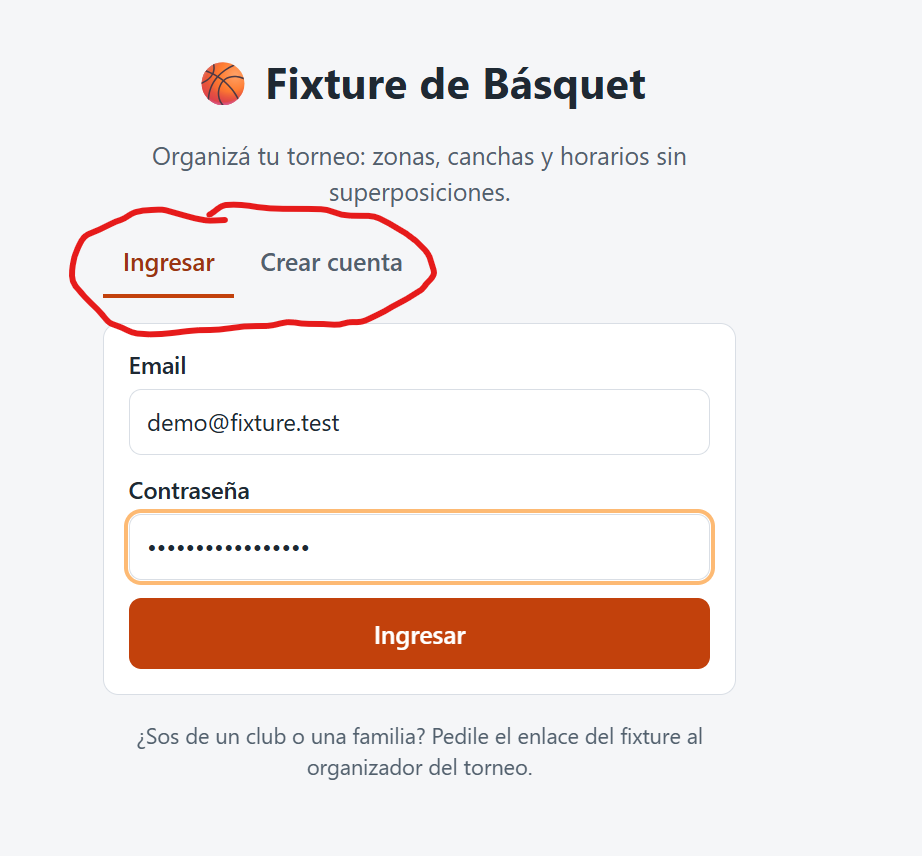
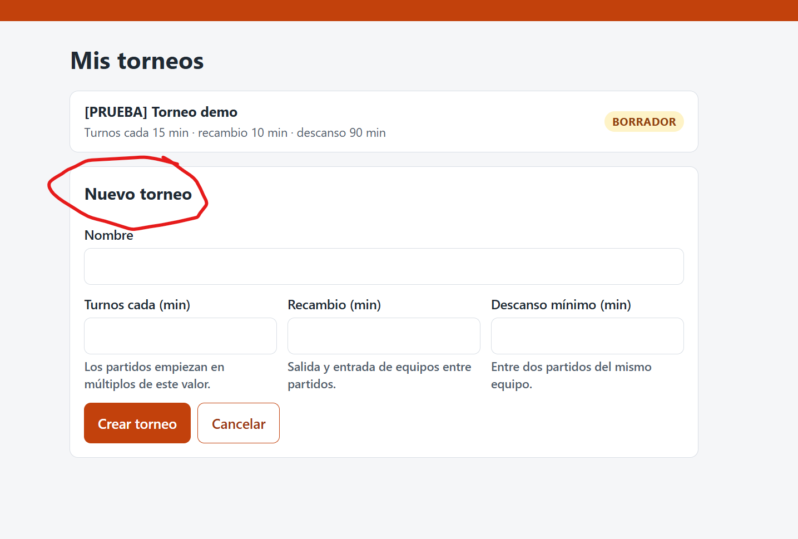
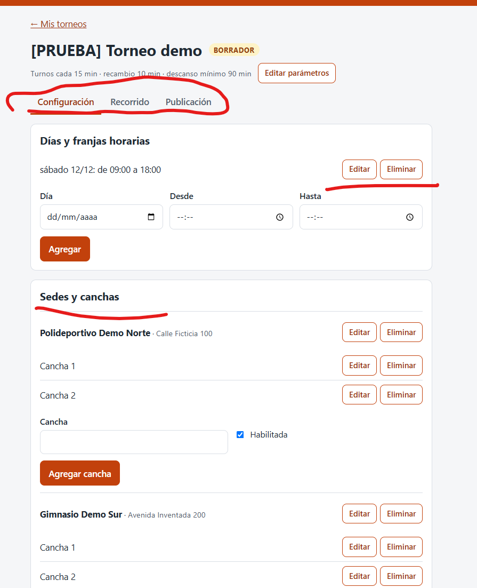
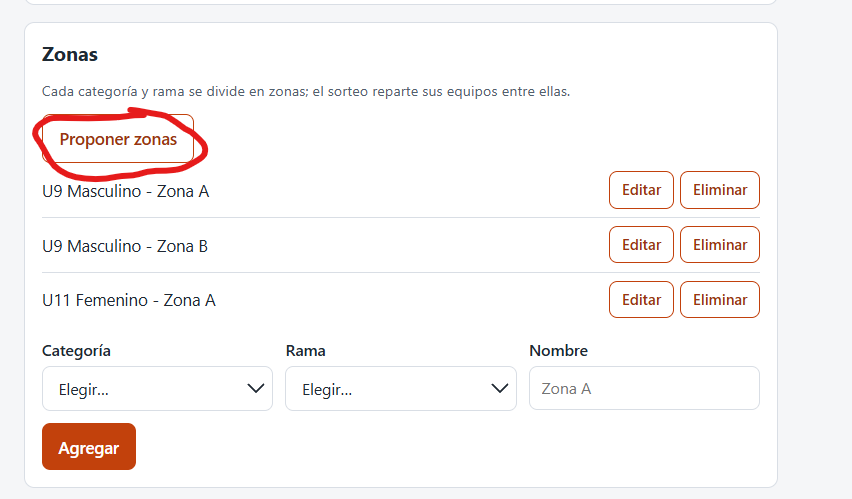
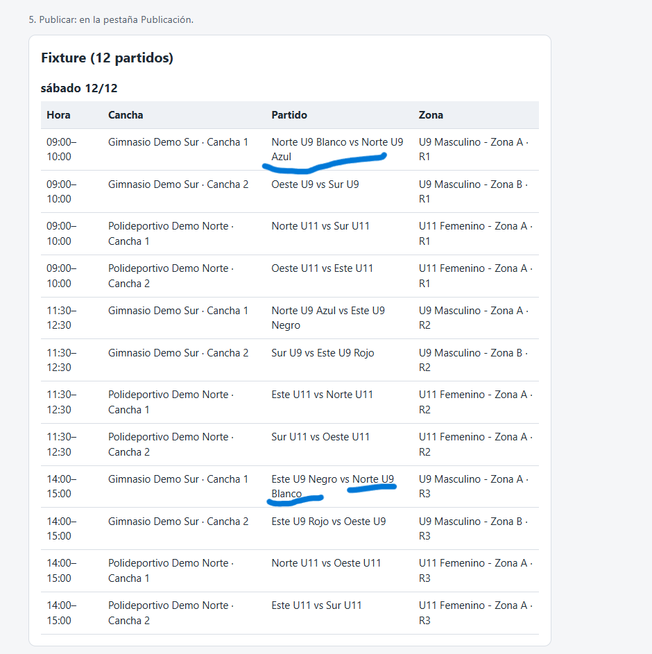
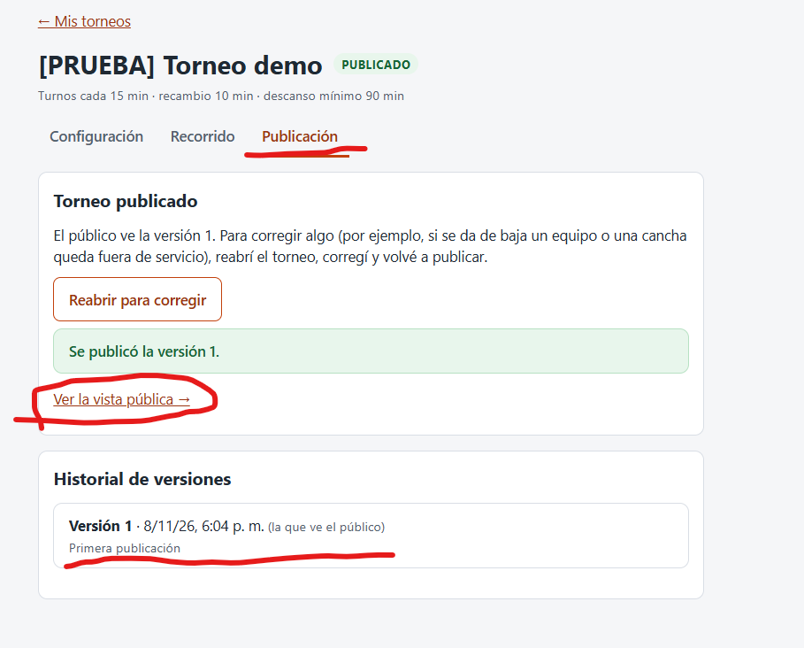
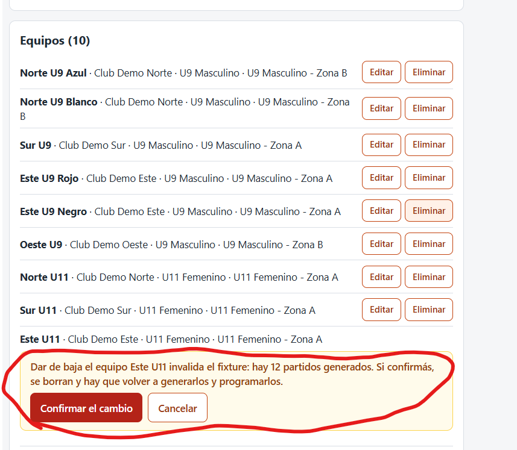
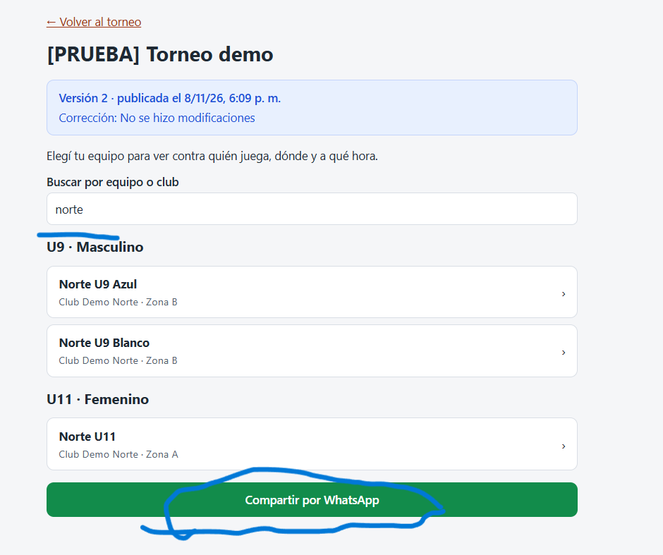
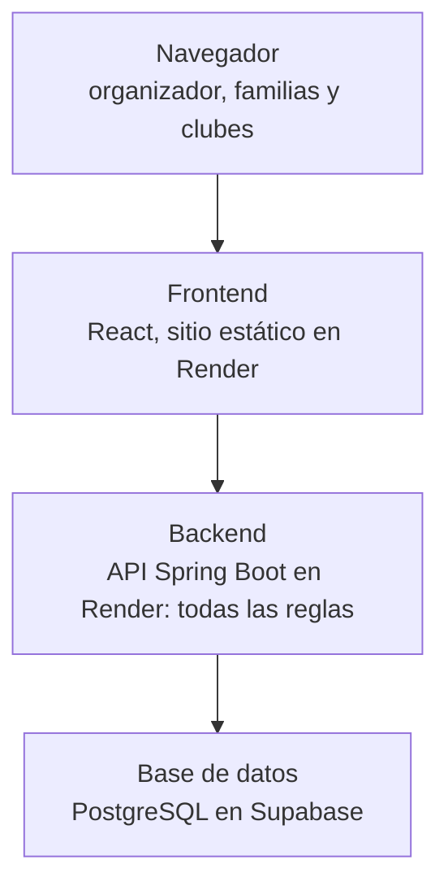

# Instructivo y glosario – Fixture de Básquet

> Versión editable del manual de usuario. Se reconstruyó a partir de
> "Instructivo y glosario – Fixture de Básquet.pdf" (versión 1.0) y se mantiene acá, junto al código.

## Ficha del documento

| | |
|---|---|
| **Sistema** | Fixture de torneos de básquet (TFI, UTN – Tecnicatura en Programación a Distancia) |
| **Tipo** | Manual de usuario con guía rápida y glosario |
| **Versión** | 1.1 |
| **Fecha de actualización** | 07/11/2026 |
| **Autores** | Daniel y Tadeo |
| **Tutor** | Oscar Londero |
| **Dirigido a** | Organizadores de torneos (usuarios de la app) y revisores del TFI |

## Informe de avance del TFI

La app está desplegada y recorre el flujo completo: torneo, configuración, zonas, programación, validación y
publicación. Este informe resume qué se incorporó desde la devolución del tutor; el resto del documento es el
instructivo de uso.

| Qué | Dónde |
|---|---|
| App (frontend) | <https://fixture-frontend-i2w8.onrender.com> |
| Vista pública de un torneo | `https://fixture-frontend-i2w8.onrender.com/torneo/ID` (ID = número del torneo publicado) |
| Estado del backend | <https://fixture-backend-anko.onrender.com/api/salud> |
| Repositorio | <https://github.com/tadeo14/tp_final> (rama `developC`, [Pull Request #2](https://github.com/tadeo14/tp_final/pull/2); todavía sin merge a `master`) |
| Cuenta de demostración | Ver credenciales de demo en el [README](../README.md#cuenta-de-demostración) |

**Qué incorporamos:**

- Autenticación: cada organizador ve y edita solo sus torneos.
- Publicación versionada: cada publicación es una foto inmutable; para cambiarla se reabre el torneo y se pide un motivo.
- Despliegue: backend en Render con base de datos en Supabase, y frontend en Render.
- Edición de la configuración solo en borrador, con confirmación cuando el cambio invalida el fixture generado.
- Propuesta automática de zonas.
- Mensajes de error en español.
- Datos de ejemplo del caso real, con sedes Atlético María Juana y Litoral María Juana (con el visto bueno del
  organizador) y clubes reales de Argentina.

> **Aviso:** al usar planes gratuitos, si la app estuvo inactiva la primera carga puede tardar cerca de un minuto.

## Cómo usar este manual

Este manual explica cómo organizar un torneo con la app, de punta a punta, sin conocimientos técnicos. Si es la primera
vez, leé la [Guía rápida](#guía-rápida-10-minutos); si buscás una palabra o una regla, andá al [Glosario](#glosario);
si algo falla, mirá [Solución de problemas](#solución-de-problemas). Los apartados técnicos (arquitectura,
repositorio) están al final y solo hacen falta para mantener el sistema.

**Contenido:** Guía rápida · Qué es la app · Enlaces y cómo entrar · Recorrido paso a paso · Estados · Versiones de
publicación · Vista pública · Glosario · Preguntas frecuentes · Solución de problemas · Límites y mejoras · Dónde está
cada cosa · Historial de cambios.

**Requisitos previos:** un navegador actualizado, el enlace de la app, y una cuenta de organizador (la de demostración
o la tuya). Alcanza con tener a mano los datos del torneo: días, sedes, canchas, horarios y equipos.

## Guía rápida (10 minutos)

Para ver la app funcionando de punta a punta:

1. Abrí el enlace de la app e ingresá con tu cuenta. Si el servicio estuvo inactivo, la primera carga puede tardar
   cerca de un minuto.
2. Creá un torneo nuevo desde **Mis torneos**.
3. En **Configuración** cargá sedes, canchas, franjas horarias, categorías, ramas, clubes y equipos, y armá las zonas
   con **Proponer zonas**.
4. En **Recorrido** sorteá, generá los enfrentamientos y programá.
5. Validar: la app revisa las restricciones R1–R8 y avisa si algo no se cumple.
6. Publicar y compartí el enlace público por WhatsApp.

Cada paso está explicado con más detalle en [Recorrido del organizador, paso a paso](#recorrido-del-organizador-paso-a-paso).

## Qué es la app

Fixture de Básquet es una app web, gratuita y en español, que arma y publica el fixture de un torneo formativo de
básquet sin superposiciones de canchas ni de equipos.

**El problema:** hoy los organizadores reparten a mano los enfrentamientos, las canchas y los horarios. Eso genera
partidos superpuestos, canchas vacías y equipos que no saben dónde ni cuándo juegan.

**Qué hace la app:**

- Guarda la configuración del torneo: días y franjas, sedes y canchas, categorías, ramas, clubes y equipos.
- Reparte los equipos en zonas por sorteo y arma los enfrentamientos (todos contra todos dentro de cada zona).
- Asigna a cada partido una cancha y un horario, respetando las restricciones obligatorias R1 a R8.
- Publica el fixture en una página de solo lectura que las familias y los clubes abren desde el celular.

**Qué no hace (por ahora):** carga de resultados, fase final o cruces, comidas, pagos, notificaciones ni roles
distintos al organizador. En la sección [Límites actuales](#límites-actuales-y-mejoras-futuras) está la lista completa.

## Enlaces y cómo entrar

La app está online: el organizador entra por el frontend, el público por el enlace de cada torneo.

| Qué | Enlace | Para quién |
|---|---|---|
| Frontend (login y panel del organizador) | <https://fixture-frontend-i2w8.onrender.com> | Organizador |
| Vista pública de un torneo | `https://fixture-frontend-i2w8.onrender.com/torneo/ID` (cambiar ID por el número del torneo) | Familias y clubes, sin login |
| Backend (API) | <https://fixture-backend-anko.onrender.com/api/salud> | Verificar que responde |
| Repositorio | <https://github.com/tadeo14/tp_final> (rama `developC`) | Equipo y tutor |

**Primer ingreso:** el login tarda hasta un minuto si nadie usó la app en los últimos 15 minutos, porque el plan
gratuito de Render "duerme" el servidor. No es un error: esperar y reintentar.

**Cuenta de demostración:** ver credenciales de demo en el [README](../README.md#cuenta-de-demostración). También se
puede crear una cuenta propia con "Crear cuenta" en la pantalla de login.

Cada organizador ve solo sus torneos. Si entrás con otra cuenta, los torneos de la cuenta de demostración no aparecen.

## Recorrido del organizador, paso a paso

La app se usa en este orden: configurar, repartir en zonas, generar los partidos, programarlos, validar y publicar.
Las pantallas del torneo tienen tres pestañas: **Configuración**, **Recorrido** y **Publicación**.

1. **Crear el torneo** ("Mis torneos" → "+ Nuevo torneo"). Se cargan el nombre y tres parámetros: *turnos cada* (cada
   cuántos minutos puede empezar un partido), *recambio* (tiempo para que una cancha pase de un partido al siguiente)
   y *descanso mínimo* (tiempo que tiene que pasar entre dos partidos del mismo equipo).

   

2. **Configuración** (primera pestaña). Se cargan:
   - Días y franjas horarias: cada día con su hora de inicio y de fin.
   - Sedes y canchas: los clubes donde se juega y sus canchas.
   - Categorías (por ejemplo U9, U11, U13): cada una con la duración de sus partidos y el máximo de partidos por día
     de un equipo.
   - Ramas (Masculino, Femenino) y clubes.
   - Equipos: nombre, club, categoría, rama, responsable y teléfono. Solo se piden esos datos personales, nada más.

   

3. **Zonas** (en la pestaña Configuración). Una zona es un grupo de equipos de la misma categoría y rama que juegan
   todos contra todos. Se pueden cargar a mano o con el botón "Proponer zonas", que calcula cuántas hacen falta según
   el máximo de equipos por zona que elijas (por defecto 5).

   

4. **Sortear** (pestaña Recorrido). Reparte al azar los equipos en las zonas. El resultado queda guardado.
5. **Generar enfrentamientos.** Arma quién juega contra quién dentro de cada zona. Si la zona tiene cantidad impar de
   equipos, en cada ronda uno queda libre.
6. **Programar.** Le asigna a cada partido una cancha y un horario sin pisar a nadie.

   

7. **Validar.** Revisa que se cumplan las restricciones obligatorias R1 a R8 y lista las que fallen.
8. **Publicar** (pestaña Publicación). Solo se puede publicar un fixture válido. Desde ese momento el público lo ve en
   el enlace del torneo.

   

Si con la configuración actual no se puede programar todo, la app no relaja ninguna regla: avisa que no existe (o no
se encontró) una programación válida y dice qué zona o equipo no pudo ubicar, para que el organizador ajuste franjas,
canchas o zonas.

## Estados: borrador y publicado

La configuración solo se modifica con el torneo en BORRADOR; un torneo PUBLICADO hay que reabrirlo primero.

| Acción | BORRADOR | PUBLICADO |
|---|---|---|
| Agregar, editar o eliminar configuración (franjas, sedes, canchas, categorías, ramas, clubes, zonas, equipos) | Sí | No (los botones se ocultan) |
| Editar los parámetros del torneo | Sí | No |
| Sortear, generar, programar y validar | Sí | No |
| Publicar | Sí, si el fixture es válido | — |
| Reabrir para corregir | — | Sí, vuelve a BORRADOR |
| Ver la vista pública | Solo si ya se publicó alguna versión | Sí |

**Confirmaciones.** Si un cambio invalida el fixture ya armado (por ejemplo, editar una franja o dar de baja un equipo
cuando ya hay partidos programados), la app avisa cuántos partidos se pierden y pide confirmar dentro de la misma
página. Al confirmar se borran los partidos generados y hay que volver a generarlos y programarlos.

**Qué no se puede borrar.** Un club con equipos, o una categoría o rama con zonas o equipos: la app lo rechaza y
explica qué lo usa.

**Cambios que reinician el sorteo.** Borrar una zona con equipos, o cambiarle la categoría o la rama a una zona o a un
equipo ya sorteado, deshace el sorteo de todo el torneo. Dar de baja un equipo, en cambio, conserva el sorteo y la
zona queda con un equipo menos.

**Fixture incompleto.** Si se agrega un equipo después del sorteo, queda sin zona y la validación impide publicar
hasta que tenga partidos.

## Versiones de publicación

Cada vez que se publica, la app guarda una versión numerada que no cambia nunca, y el público siempre ve la última
versión publicada.

Ejemplo de una corrección después de publicar:

1. El organizador publica: nace la versión 1, sin motivo.
2. Detecta un error y toca **Reabrir**. El torneo vuelve a BORRADOR, pero el público sigue viendo la versión 1.
3. Corrige la configuración y vuelve a generar, programar y validar.
4. Publica de nuevo. Desde la versión 2 la app exige escribir el motivo de la corrección.
5. El público pasa a ver la versión 2, con el número de versión, la fecha y el motivo a la vista.

La pestaña Publicación muestra el historial de versiones con número, fecha y motivo.

**Por qué es una "foto".** Cada versión copia el nombre del torneo y, partido por partido, los equipos, el club de cada
uno, la categoría, la rama, la zona, la ronda, la sede, la cancha, el inicio y el fin. Por eso, si después se renombra
el torneo o un club, o se cambia la duración de una categoría, lo que ya se comunicó no se modifica: el nombre nuevo
aparece recién en la próxima publicación.

## Vista pública

Las familias y los clubes ven el fixture desde un enlace, sin crear cuenta ni iniciar sesión, y está pensado para
abrirse en el celular.

- **Lista de equipos** (`/torneo/ID`): equipos agrupados por categoría y rama, con su club y su zona, y un buscador por
  nombre de equipo o de club.
- **Fixture de un equipo** (`/torneo/ID/equipo/ID`): para cada partido, día y hora, rival (con su club), sede y cancha,
  ronda y si juega de local o de visitante. Si hay una ronda sin partido, dice "Fecha libre".
- **Compartir:** un botón arma un mensaje de WhatsApp con el enlace. Se puede mandar tanto el del torneo como el de un
  equipo en particular.
- **Versión:** arriba se ve el número de versión y la fecha de publicación, y el motivo si hubo una corrección.

La vista pública no muestra el responsable ni el teléfono de los equipos, y un torneo que nunca se publicó no aparece.
Si el organizador la abre con su sesión iniciada, ve además el enlace "← Volver al torneo".

## Glosario

Los términos de la app, en el orden en que aparecen en el recorrido.

| Término | Qué significa |
|---|---|
| Organizador | Usuario con cuenta que crea y administra torneos. Es el único rol: ve y edita solo los suyos |
| Torneo | El evento completo: sus parámetros, su configuración y su fixture |
| Sede | Club o predio donde se juega |
| Cancha | Cada cancha de una sede. Se puede habilitar o deshabilitar |
| Franja horaria | Ventana de un día en la que se puede jugar (por ejemplo, sábado de 9:00 a 20:00) |
| Categoría | Nivel por edad, por ejemplo U9, U11 o U13. Cada una define la duración de sus partidos y el máximo de partidos por día de un equipo |
| Rama | Masculino o Femenino |
| Club | Institución de la que son los equipos. Un club puede tener equipos en varias categorías y ramas |
| Equipo | Participante de una categoría y una rama, con su club, un responsable y un teléfono |
| Zona | Grupo de equipos de la misma categoría y rama que juegan todos contra todos |
| Proponer zonas | Botón que calcula cuántas zonas crear según el máximo de equipos por zona |
| Sorteo | Reparto al azar de los equipos en las zonas. El resultado se guarda |
| Enfrentamiento | Un partido entre dos equipos de una misma zona, todavía sin cancha ni horario |
| Ronda | Tanda de partidos de una zona en la que cada equipo juega como mucho una vez |
| Fecha libre | Ronda en la que un equipo no juega, porque su zona tiene cantidad impar de equipos |
| Programación | Asignar cancha y horario a cada partido |
| Turnos cada | Cada cuántos minutos puede empezar un partido (por ejemplo, cada 15) |
| Recambio | Minutos que se reservan en la cancha entre un partido y el siguiente |
| Descanso mínimo | Tiempo mínimo entre dos partidos del mismo equipo |
| Bloque | Tiempo que ocupa un partido en la cancha: juego, pausas, margen y recambio, redondeado al múltiplo de "turnos cada". Se calcula, no se guarda |
| Validación | Chequeo de las restricciones obligatorias R1 a R8 |
| BORRADOR / PUBLICADO | Estado del torneo. Solo en BORRADOR se modifica |
| Versión | Publicación numerada y fija del fixture. El público ve la última |
| Reabrir | Volver de PUBLICADO a BORRADOR para corregir, sin que el público pierda la última versión |
| Vista pública | Página de solo lectura con el fixture, sin login |

**Las restricciones obligatorias.** Un fixture que viola cualquiera de ellas no se publica.

| # | Regla |
|---|---|
| R1 | Una cancha no tiene dos partidos al mismo tiempo |
| R2 | Un equipo no juega dos partidos al mismo tiempo |
| R3 | Se respeta el descanso mínimo entre partidos del mismo equipo |
| R4 | Cada partido empieza y termina dentro de una franja habilitada |
| R5 | Cada partido está en una cancha habilitada del torneo |
| R6 | Un equipo no juega más del máximo de partidos por día |
| R7 | Cada partido empieza en un turno válido (9:00, 9:15, 9:30… si es cada 15) |
| R8 | Todos los partidos están programados y todo equipo inscripto tiene partidos |

## Preguntas frecuentes

**¿Puedo cambiar algo después de publicar?** No directamente: hay que reabrir el torneo, y desde la versión 2 la app
pide un motivo. La versión anterior queda guardada.

**¿Qué pasa si agrego o borro un equipo con el fixture ya generado?** Si lo **das de baja**, la app pide confirmación
y, si aceptás, descarta los partidos generados; el sorteo se conserva y alcanza con volver a generar y programar. Si lo
**agregás**, no pide confirmación: el equipo nuevo queda sin zona y no se puede publicar hasta volver a sortear,
generar y programar.

**¿Quién puede ver mi torneo?** Solo vos mientras está en borrador; los demás organizadores no lo ven. Al publicar,
cualquiera con el enlace público puede consultarlo, sin cuenta.

**¿Las zonas se crean solas?** No: se arman con **Proponer zonas**, en la pestaña Configuración, y después se sortean.
El máximo de equipos por zona viene en 5 y no puede ser menor que 3; con cualquier máximo válido, cada zona queda con
al menos 2 equipos.

**¿Por qué no veo los botones Editar y Eliminar?** Solo aparecen con el torneo en BORRADOR. Si está PUBLICADO,
reabrilo primero.

## Solución de problemas

| Síntoma | Causa probable | Qué hacer |
|---|---|---|
| La página tarda cerca de un minuto en cargar o no responde | El servicio gratuito se duerme tras 15 minutos sin uso | Esperá y recargá; si persiste, abrí primero el enlace de salud del backend |
| "No existe una programación válida con la configuración actual" | La app comprobó que no alcanzan canchas, horarios o descansos | Agregá canchas o franjas, o reducí equipos o descanso; no se relajan reglas |
| "No se encontró una programación válida..." | El método automático no encontró solución, aunque podría existir | Ajustá la configuración y volvé a programar |
| Hay equipos sin partidos y no se puede publicar | El fixture quedó incompleto (R8), por ejemplo porque se agregó un equipo después del sorteo | Volvé a sortear, generar y programar |
| El enlace público manda al login | Se abrió la dirección raíz de la app | Usá la dirección con el formato `/torneo/ID` |

Si el problema no figura acá, avisá a Daniel o Tadeo con una captura y la hora aproximada del error.

## Límites actuales y mejoras futuras

La versión actual cubre el recorrido completo de un torneo de fase de zonas; lo que sigue queda fuera a propósito.

**Fuera del alcance de esta entrega:**

- Fase final o cruces entre zonas.
- Carga de resultados y estadísticas.
- Logística de comidas (se descartó por ahora).
- Edición manual de un partido suelto, y arrastrar partidos en un calendario.
- Pagos, notificaciones y roles distintos al organizador.

**Limitaciones que conviene conocer:**

- El programador es "greedy": llena el primer horario válido que encuentra y no vuelve atrás. Por eso distingue dos
  mensajes: "No existe una programación válida" (un chequeo por conteo demuestra que es imposible) y "No se encontró
  una programación válida" (no se pudo ubicar un partido, pero eso no prueba que no haya solución).
- Reparto entre los dos días: como el programador llena primero el sábado, hay equipos que juegan un solo día. Se
  consultó al organizador real, que no tiene problema con eso, y el reparto parejo queda como mejora futura.
- El sorteo siempre rehace todo el torneo: no se puede volver a sortear una sola categoría.
- Un equipo puede jugar en dos sedes el mismo día.
- El alta de un equipo después del sorteo lo deja sin zona: hay que volver a sortear antes de publicar.
- Infraestructura gratuita: el servidor se duerme tras 15 minutos sin uso (el primer pedido tarda cerca de un
  minuto), la base de Supabase se pausa tras una semana sin actividad y ninguno de los dos planes gratuitos hace
  copias de seguridad confiables. Se resuelve con un `pg_dump` periódico.

## Dónde está cada cosa

La app tiene cuatro piezas: el navegador, el frontend, el backend y la base de datos, y los dos servicios web de
Render salen de la rama `developC`.

El backend concentra todas las reglas: el frontend solo muestra lo que él responde y la base solo guarda.

El repositorio (`tadeo14/tp_final`) se organiza así:

| Carpeta o archivo | Qué hay |
|---|---|
| `/backend` | Proyecto Spring Boot, tests y las migraciones de la base (`src/main/resources/db/migration`) |
| `/frontend` | App React con Vite: panel del organizador y vista pública |
| `/database` | Datos de ejemplo: `caso_real.sql` (el torneo del caso real) y `demo.sql` (el torneo de prueba de la cuenta de demostración) |
| `/docs` | Documentación: `caso-real.md`, `restricciones.md`, `decisiones.md`, `der.md`, `algoritmo-enfrentamientos.md`, `algoritmo-programador.md`, `deploy.md`, `hoja-de-ruta.md` y este manual |
| `render.yaml` (raíz) | Definición de los servicios de Render |

Para entender por qué se tomó cada decisión técnica, el lugar es [`docs/decisiones.md`](decisiones.md): cada una
tiene número (D1, D2…) y una justificación de dos o tres líneas.

## Historial de cambios

| Versión | Fecha | Cambio | Autor |
|---|---|---|---|
| 1.1 | 07/11/2026 | Versión editable en el repositorio (`docs/manual-usuario.md`), reconstruida del PDF 1.0. Correcciones: cuenta de demostración remitida al README; el nombre del torneo también queda congelado en cada versión (D70); "Proponer zonas" está en Configuración; regla del máximo por zona en la FAQ; la rama principal es `master`; alta y baja de equipos en la FAQ; qué hacer con equipos sin partidos; botón "Crear cuenta"; `demo.sql` en `/database` | Tadeo |
| 1.0 | 25/10/2026 | Estructura según la teoría de manuales (ficha, guía rápida, FAQ, solución de problemas, historial) | Tadeo |
| 0.9 | 24/10/2026 | Primer borrador: recorrido, estados, versiones, glosario | Tadeo |

## Pendientes y revisión

Este manual se revisa cada vez que cambia la app. Comentarios y correcciones: dejalos como comentario en este
documento o avisá a Tadeo.

- Capturas anotadas del recorrido: agregadas en `docs/img/manual/` (login, nuevo torneo, configuración, zonas,
  recorrido, publicación, confirmación de un cambio y vista pública).
- Revisión de Daniel.
- Revisión de Oscar.
